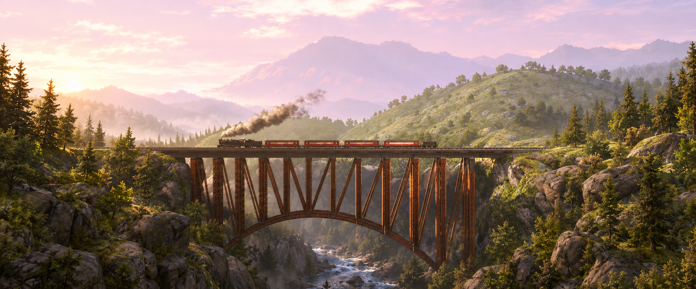

# Expanded loading artwork

Version 0.3.0 recreates the game's five loading scenes as continuous ultrawide
panoramas. New scenery extends the composition horizontally; the original
picture is not stretched. The game still selects its own random scene and draws
its native loading message and progress indicator separately.

## Artwork and provenance

Created on 2026-10-11 with OpenAI's built-in ImageGen tool, one generation per
scene. Locally decoded original texture atlases were supplied as visual
references. Those original images are not distributed. These are AI-assisted
reinterpretations, not pixel-preserving outpaints of the original artwork.

| Native variant | Scene | Generated source | Source size |
| --- | --- | --- | --- |
| Base / 5 | Trestle bridge and passenger train | `loading-bridge.png` | 1942×809 |
| 1 | Penny on a rail | `loading-penny.png` | 1942×809 |
| 2 | Steam locomotive cab | `loading-cab.png` | 1941×810 |
| 3 | Covered railway station | `loading-station.png` | 1942×809 |
| 4 | Freight yard and caboose | `loading-yard.png` | 1942×809 |

All sources are in [`rt3_ultrawide/assets/`](../rt3_ultrawide/assets/).
The exact final prompt for each scene is preserved in
[`loading-prompts.json`](../rt3_ultrawide/assets/loading-prompts.json).
3440×1440 was the requested generation target; actual returned dimensions are
listed above. Rendering scales the artwork uniformly to the display, cropping
the sides or top/bottom to cover other aspect ratios. No horizontal distortion
is applied. The base atlas and variant 5 were identical in the original game,
so both use the bridge panorama.

## Texture packaging and restoration

`tools/build_loading_assets.py` reproducibly encodes these PNGs using Pillow
12.3.0. Each image is stored without resizing in a padded 2048×1024 texture.
Six DXT5 levels (A–F, down to 64×32) are encoded for each of the six atlas names,
yielding 36 same-size payloads in `loading-backgrounds.pk4`.
`loading-backgrounds.json` records the archive checksum and each scene's visible
bounds. Runtime texture coordinates exclude the storage padding.

`loading-originals.json` contains directory identifiers and SHA-256 fingerprints
only. The installer validates those original fingerprints or the exact installed
replacement, and rejects unfamiliar textures. It patches only these payloads
and the six menu payloads in the player's `Data/2D/rt3_2DDS.PK4`. The original
directory, file length, and unrelated bytes remain unchanged. The first complete
archive backup is retained through upgrades; **Restore original** restores it.

Always start through **Launch RT3 Ultrawide.cmd**. Steam's regular Play button
does not activate the runtime background layout correction.

## Runtime mapping

For the supported Steam executable:

- `0x4ea620`: LoadScreen constructor; vtable `0x5d1194`.
- `0x6d10b0`: current LoadScreen window pointer.
- Options pointer `0x6cec74`, byte `+0x2c7`: last randomly selected variant,
  set by the native constructor before changing the three controls' image names.
- Control **34003** draws the full-display background with that variant's UVs.
- Controls **34004/34005** are the old rotated lower fragments; their drawing
  flag is temporarily suppressed and restored after each draw.
- Loading status/progress controls retain normal proportional UI rendering.

The loading window can draw outside a regular UI frame. Its drawing scope
therefore establishes a UI transform when needed and restores the previous
depth afterward. No extra Frida session, save-file edits, executable edits,
forced variant selection, or artificial loading delay are introduced.

See [validation](VALIDATION.md) for the tested resolution and remaining limits,
and [third-party notices](../THIRD_PARTY.md) for underlying artwork rights.
